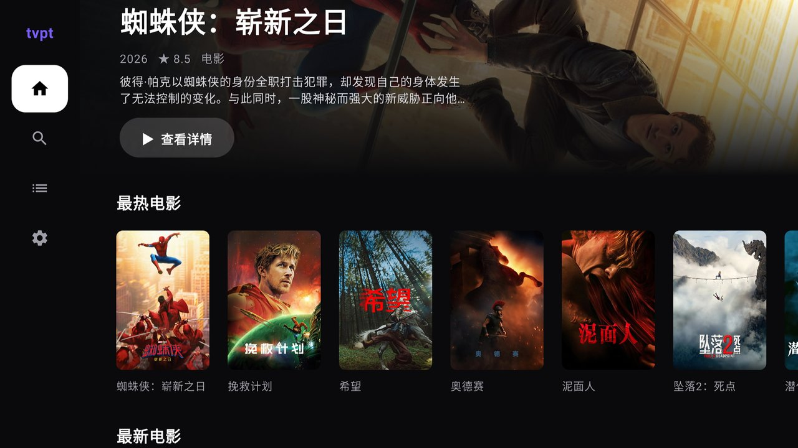
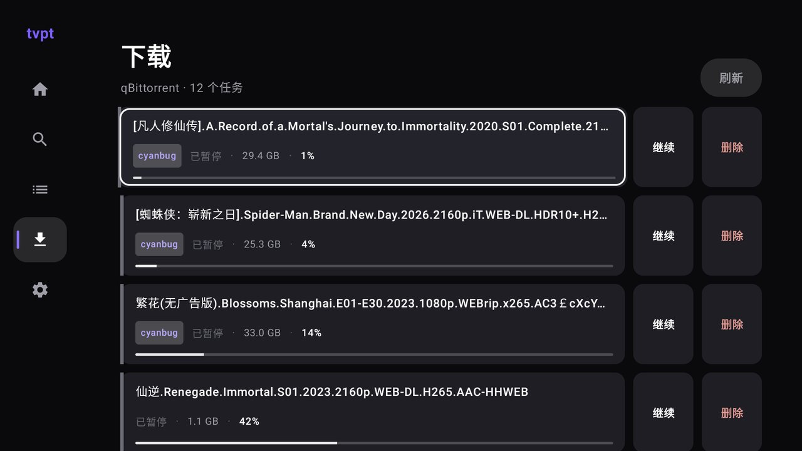

# tvpt — 你自己的电视，你自己的片库

tvpt 是一套自托管的家庭影院系统：一台你自己的服务器，加一台 Android TV。
在电视上浏览、搜索影视，选中即边下边播；下载、做种、清理都由后端自动完成，
不需要任何第三方网盘或在线片源站。

**你的数据只在你家。** 全部组件运行在你自己的硬件上；TMDB 密钥只保存在
服务端，不下发到电视端；系统没有账号体系、不回传任何数据。索引器、内容
来源由你自己接入，你只看你有权限看的内容。

安装 · [快速开始](#快速开始) · [它如何组合](#它如何组合) · [安全](#安全) · [文档](#文档) · [开发](#开发)

| 电视端首页 | 下载管理 |
|---|---|
|  |  |

## 安装

前置条件：

* 一台能跑 Docker 的机器（NAS 或小主机均可），装好 Docker 与 Docker Compose
* 一台 Android TV 或电视盒子（Android 6.0+）
* 一个你自己的 [TMDB](https://www.themoviedb.org/) API Key（免费申请）
* 你自己有权使用的索引器（在 Prowlarr 中配置）

先准备环境变量：

```bash
cp .env.example .env
```

| 变量 | 必填 | 说明 |
|---|---|---|
| `QB_PASSWORD` | 是 | qBittorrent 密码。**首次启动前**就设好，避免默认密码窗口期 |
| `PROWLARR_API_KEY` | 是 | Prowlarr 网页端 Settings → General 里生成 |
| `TMDB_API_KEY` | 是 | tvapi 使用；`.env.example` 未列出，在 `.env` 里自行加一行 |
| `TVPT_EXTERNAL_URL` | 否 | 服务对外地址；电视端经域名访问时填写 |
| `PROWLARR_PROXY_*` | 否 | Prowlarr 出站代理（索引器无法直连时用） |
| `TVAPI_PROXY` | 否 | tvapi 访问 TMDB 的代理；默认走宿主机 `7800` 端口，无代理环境请置空 |

构建 Seedstrem 修改版镜像并启动全部服务：

```bash
cd vendor/seedstrem && docker build --network=host -f Dockerfile.patch -t tvpt/seedstrem:patched . && cd ../..
docker compose up -d
```

可选 HTTPS 入口（nginx，443 HTTPS / 8082 HTTP）：把 `config/nginx-tvpt.conf`
里的示例域名换成你的域名，证书用 `scripts/https-cert.sh` 签发并放在仓库外，然后：

```bash
docker compose -f docker-compose.yml -f docker-compose.https.yml up -d
```

## 快速开始

先验证后端活着：

```bash
curl http://127.0.0.1:8081/api/health       # Seedstrem，应返回正常状态
curl http://127.0.0.1:8082/api/tv/health    # tvapi（经 nginx 同源入口）
```

首次配置，按顺序做完这四步：

1. **qBittorrent**（`http://<主机>:8080`）：执行一次
   `QB_PASSWORD=<你的密码> ./scripts/qb-pt-prefs.sh`。它关闭 DHT/PeX/LSD
   （私有种子的硬性要求）、避开会被站点拉黑的默认监听端口段、开启下载队列。
2. **Prowlarr**（`http://<主机>:9696`）：添加你的索引器，确认能搜到结果。
3. **Seedstrem**：把 Prowlarr、qBittorrent 的连接信息填入
   `config/seedstrem.yaml` 对应字段（文件内有注释），重启 seedstrem 服务。
4. **电视端**：安装客户端 APK（见[开发](#开发)），打开后在「设置」里填入
   服务器地址（如 `https://tvpt.example.com`，或局域网 `http://<主机>:8082`）。

完成标准：电视端首页能刷出分类海报，搜一部片、点一集，能开始播放——
就说明整条链路通了。

## 它如何组合

```
Android TV 客户端 (Kotlin / Jetpack Compose)
        │  只请求同源 /api/tv/*
        ▼
   tvapi (Go) ────── TMDB API（密钥只在服务端）
        │
        ├── Seedstrem ── Prowlarr（索引器聚合）
        └── qBittorrent（下载 / 做种 / 文件服务）
```

* **电视客户端**（`client-tv/`）：分类首页、中英文搜索、详情与分集、
  结构化片源列表、自研播放器（字幕/音轨切换、OSD）、继续观看、
  稍后观看、下载管理。遥控器优先的焦点式 UI。
* **tvapi**（`server/tvapi/`）：电视端唯一对接的后端。代理 TMDB 并缓存，
  把片源按集过滤后返回结构化结果，代理图片，直连 qBittorrent 做下载管理；
  「稍后观看」由它定时向 Seedstrem 续期保活。
* **Seedstrem**（`vendor/seedstrem/`，上游修改版）：聚合各索引器的片源，
  以 qBittorrent 为下载引擎边下边播；没有磁力链的 `.torrent` 结果在
  播放时才懒解析，不拖慢片源列表。
* **qBittorrent**：实际下载与做种。镜像固定 `4.6.7-libtorrentv1`——
  5.x 的 libtorrent 2.0 会破坏顺序下载与首尾分片优先，边下边播不可用。

播放策略（`config/seedstrem.yaml` 的 `playback:` 一节）：

* 点播的种子以最高优先级下载，播完自动把整包下完、继续做种；
* 停播 5 分钟，未完成的种子自动暂停，腾出带宽与连接数；
* 保留期 72 小时，每再次播放顺延 24 小时；
* 到期且没再看过的，种子与文件自动删除。

## 安全

* **管理端口不要暴露公网。** qBittorrent（8080）、Prowlarr（9696）、
  Seedstrem（8081）都是管理面，只应在局域网访问；对外只开放 nginx 的
  443 / 8082。tvapi 本身没有账号鉴权，它的安全模型就是「同源 + 内网」。
* **密码在首启前设定。** `QB_PASSWORD` 留空或事后才改，qBittorrent
  首启生成的默认密码会有被人抢先的风险。
* **凭据不进仓库。** 所有密钥只写 `.env` 与服务端配置；证书私钥放在
  仓库外目录，`certs/` 与 `*.pem` 已被 `.gitignore` 排除。

## 文档

| 目标 | 从这里开始 |
|---|---|
| 部署与首次配置 | 本页[安装](#安装)与[快速开始](#快速开始) |
| 调整播放/清理策略 | `config/seedstrem.yaml` 的 `playback:` 与 `cleanup:` 注释 |
| 开发电视客户端 | [开发](#开发) 一节与 `client-tv/` 源码 |
| 对接或调试后端接口 | 下方[接口参考](#接口参考) |
| 换域名 / 签证书 | `config/nginx-tvpt.conf` 与 `scripts/https-cert.sh` |
| 看更多界面截图 | [docs/screenshots/](docs/screenshots/) |

## 接口参考

电视端与 tvapi 之间的全部接口：

| 方法 | 路径 | 用途 |
|---|---|---|
| GET | `/api/tv/health` | 健康检查 |
| GET | `/api/tv/trending` | 首页「热门」流 |
| GET | `/api/tv/list` | 分类流（`feed` 取分类，`page` 翻页） |
| GET | `/api/tv/search` | 搜索（中英文自动判定 TMDB 语言） |
| GET | `/api/tv/detail` | 详情；无 IMDb ID 的条目返回 `E_NO_IMDB` |
| GET | `/api/tv/season` | 分季分集 |
| GET | `/api/tv/streams` | 片源列表（按目标集过滤、结构化） |
| GET | `/api/tv/img/` | TMDB 图片代理（服务端缓存） |
| GET | `/api/tv/downloads` | 下载列表（含站点、进度、本机文件路径） |
| POST | `/api/tv/downloads/action` | 下载操作：暂停/恢复/置顶/删除等 |
| POST | `/api/tv/download` | 加入稍后观看队列 |

## 开发

电视客户端（仓库不含 Gradle wrapper 与 `local.properties`，用本机工具链：
JDK 17、Android SDK 34、Gradle 8.7）：

```bash
# client-tv/local.properties 写入一行：sdk.dir=<你的 Android SDK 路径>
# 想让打包出来的 APK 默认连你的服务器，再加一行（仓库里只放占位符）：
#   tvpt.baseUrl=https://你的域名
cd client-tv && gradle assembleDebug
adb connect <电视IP>:5555
adb install -r app/build/outputs/apk/debug/app-debug.apk
```

tvapi（Go 服务，监听 `:8080`，靠环境变量配置）：

```bash
cd server/tvapi
TMDB_API_KEY=<你的Key> SEEDSTREM_BASE=http://127.0.0.1:8081 go run .
```

仓库结构：

```
client-tv/    Android TV 客户端（Kotlin）
server/tvapi/ Go 聚合服务
vendor/       Seedstrem 上游代码与本项目的修改（自带 LICENSE）
config/       Seedstrem 与 nginx 配置模板
scripts/      运维脚本：qB 偏好 / Prowlarr 代理 / 证书 / 诊断
tools/        诊断与测试工具
docs/         界面截图
```

## 许可

* 本项目原创部分（tvapi、电视客户端、脚本与配置）以 MIT 协议发布，见根目录 [LICENSE](LICENSE)。
* `vendor/seedstrem/` 为第三方项目，遵循其自带的 MIT LICENSE。

本项目仅供个人学习与自托管使用；请只索引、下载你有权访问的内容，
并遵守所在地法律法规与内容来源站点的规则。
